<div align="center">

# 🎣 Clickbait News Detection and Analysis

### Bachelor Thesis · Warsaw University of Technology

*Faculty of Mathematics and Information Science*

[](https://www.python.org/)
[](notebooks)
[](final_models)
[](notebooks)
[](notebooks)
[](extension)
[](environments)

**🏆 Best model: XGBoost + OpenAI embeddings + informativeness measures → F1-score = 0.909**

[Abstract](#-abstract) •
[Data](#-data) •
[Baitness measure](#-baitness-measure) •
[Results](#-results) •
[Browser Extension](#-browser-extension-clickguard) •
[Project Structure](#-project-structure) •
[Setup](#%EF%B8%8F-setup) •
[Authors](#-authors)

<br/>

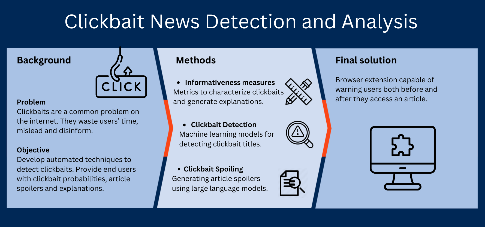

</div>

---

## 📖 Abstract

This engineering thesis analyses **clickbait articles** using machine learning and artificial intelligence methods. A review of existing research led us to create a custom metric, the **_baitness measure_**, which measures how clickbait-like an article is.

<table>
<tr>
<td width="50%" valign="top">

### 🔍 Detection
- NLP techniques to find patterns in **article titles**
- ML models trained on vectorized text representations
- Transformer-based LLMs used to turn text into **embeddings**
- 15 **informativeness measures**, including the custom **baitness measure**

</td>
<td width="50%" valign="top">

### ✨ Spoiling & Explanation
- Generative AI **summarizes suspicious articles**
- One- to two-sentence spoiler: is it worth your time?
- Predictions **explained** using the analysed metrics
- Shown to users in a **browser extension**

</td>
</tr>
</table>

---

## 🔄 Pipeline

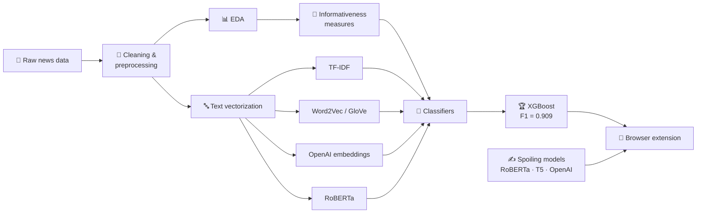

---

## 📚 Data

We merged several public clickbait datasets (two Kaggle datasets and the Clickbait Challenge) into one balanced dataset of news titles.

<div align="center">
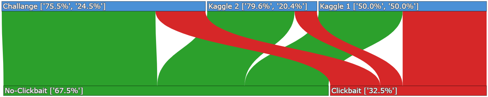
<br/><sub><i>Clickbait distribution by source dataset.</i></sub>
<br/><br/>
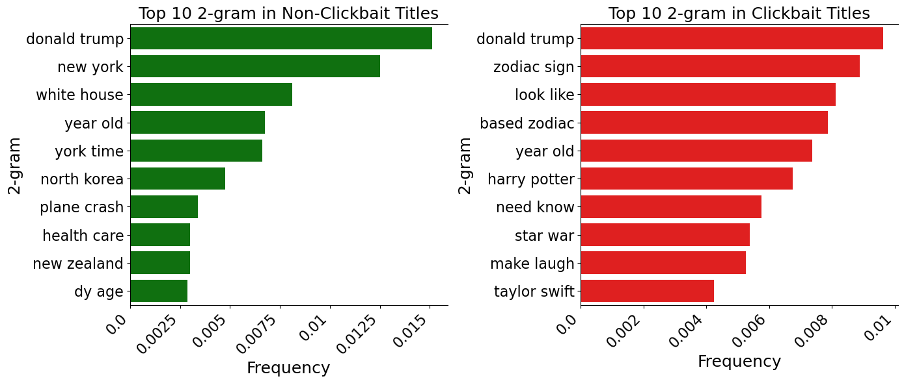
<br/><sub><i>Most frequent 2-grams in non-clickbait (green) and clickbait (red) titles.</i></sub>
</div>

---

## 📐 Baitness measure

A custom score built from informativeness measures such as capital letters ratio, second-person pronouns, bait phrases, superlatives, punctuation and readability. **On its own it reaches ROC-AUC = 0.83.**

<p align="center">
  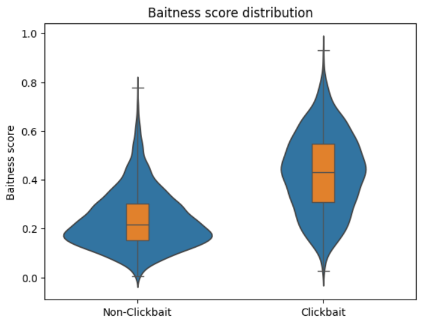
  &nbsp;
  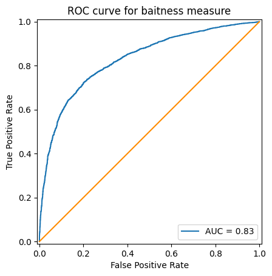
</p>
<p align="center"><sub><i>Left: baitness score for non-clickbait vs. clickbait titles. Right: ROC curve of the baitness measure used as a classifier (test set).</i></sub></p>

---

## 📊 Results

<div align="center">
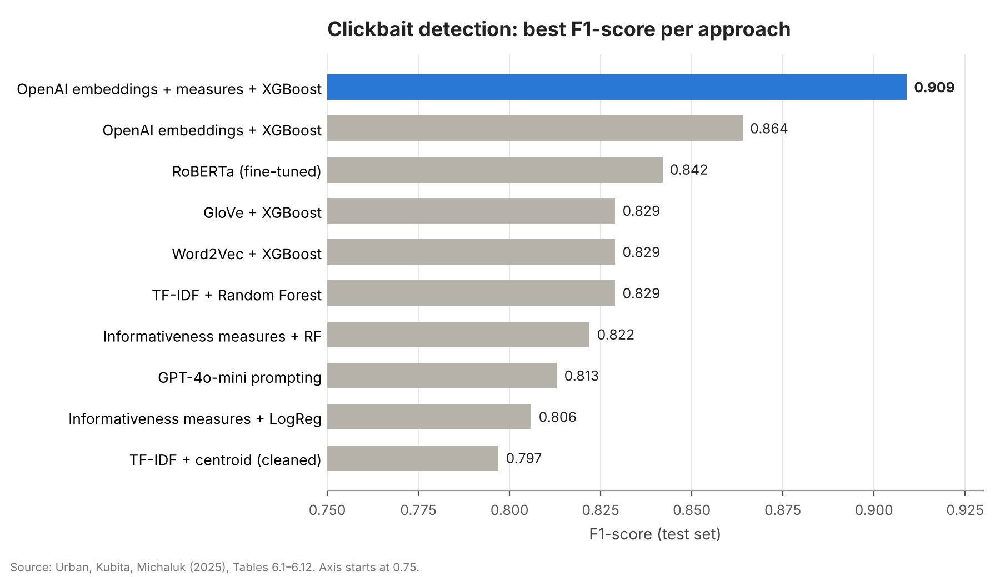
</div>

<br/>

<div align="center">

| Approach | Model | F1-score | ROC-AUC |
|:--|:--|:--:|:--:|
| Informativeness measures | Logistic Regression | 0.806 | 0.873 |
| Informativeness measures | Random Forest | 0.822 | 0.897 |
| TF-IDF (raw titles) | Random Forest | 0.829 | 0.906 |
| Word2Vec (Google News) | XGBoost | 0.829 | 0.908 |
| GloVe | XGBoost | 0.829 | 0.908 |
| Direct prompting | GPT-4o-mini | 0.813 | – |
| Fine-tuned transformer | RoBERTa | 0.842 | 0.910 |
| OpenAI embeddings (3072-d) | XGBoost | 0.864 | 0.938 |
| **OpenAI embeddings (1000-d) + informativeness measures** ⭐ | **XGBoost** | **0.909** | **0.969** |

</div>

<p align="center">
  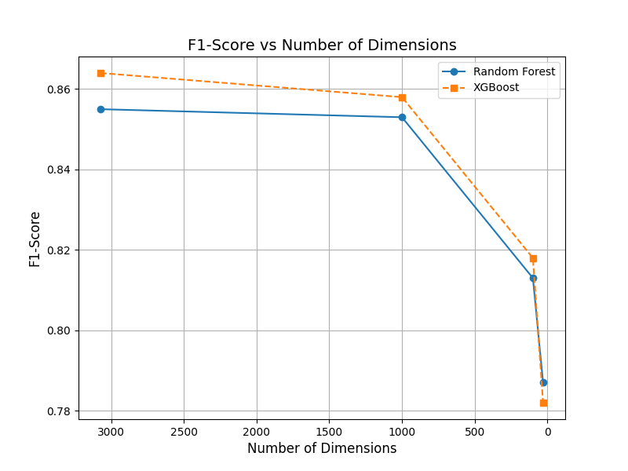
  &nbsp;
  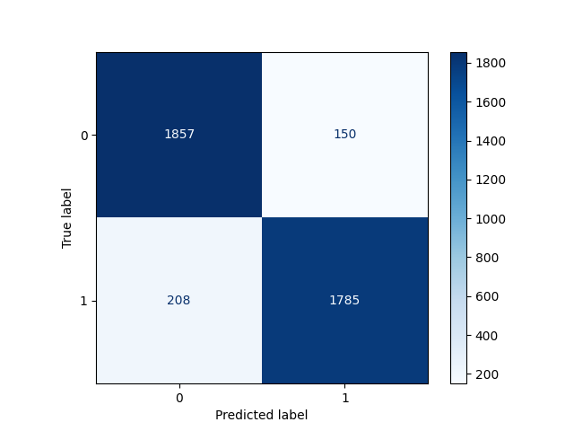
</p>
<p align="center"><sub><i>Left: effect of the number of OpenAI embedding dimensions on F1-score. Right: confusion matrix of the best model (XGBoost, 1000-d embeddings + informativeness measures).</i></sub></p>

---

## 🧩 Browser Extension: Clickguard

A fully working extension for **Chromium-based browsers** (Chrome, Edge, Brave, Opera) that protects users **before and after** they open a clickbait article.

<table>
<tr>
<td align="center" width="40%">
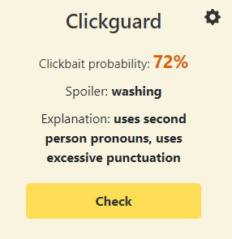
<br/><b>📈 Score, spoiler & explanation</b><br/><sub>Clickbait probability, a short spoiler and the reasons behind the prediction</sub>
</td>
<td align="center" width="60%">
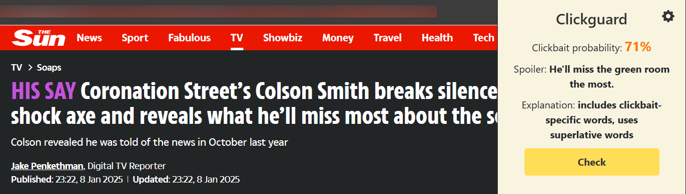
<br/><b>📰 Post-click detection</b><br/><sub>Probable (71%) clickbait with spoiler and explanation</sub>
</td>
</tr>
<tr>
<td align="center" width="40%">
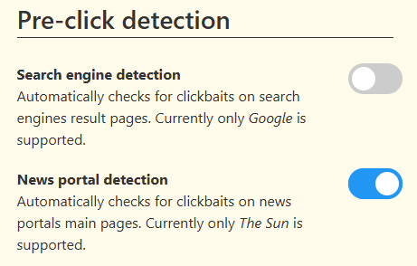
<br/><b>⚙️ Pre-click settings</b><br/><sub>Search engine and news portal detection</sub>
</td>
<td align="center" width="60%">
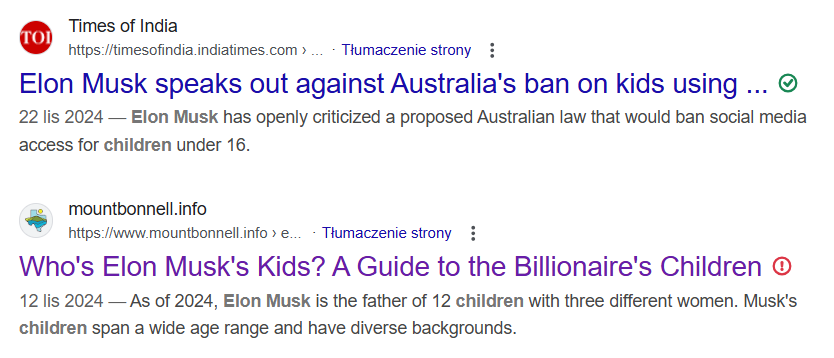
<br/><b>⚠️ Pre-click warnings</b><br/><sub>Clickbait links flagged in search results before you click</sub>
</td>
</tr>
</table>

### Architecture

<div align="center">
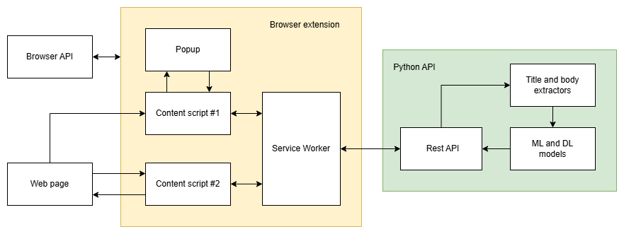
</div>

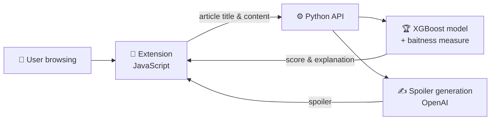

---

## 📁 Project Structure

```
ClickbaitDetectionThesis/
├── api/             # Python backend service for the browser extension
├── assets/          # Images used in this README
├── data/            # Original and preprocessed data
├── environments/    # Conda environment files
├── extension/       # JavaScript code of the browser extension
├── final_models/    # Final models used by the extension
├── notebooks/       # Jupyter notebooks (research & experiments)
└── other/           # Minor utilities
```

<details>
<summary><b>📓 Notebooks overview (click to expand)</b></summary>

<br/>

| # | Notebook | Description |
|:--:|:--|:--|
| 0 | `0-Function-Helper` | Frequently used helper functions |
| 1 | `1-Getting-Data` | Downloading, saving and merging data; pre-cleaning |
| 2 | `2-EDA` | Exploratory data analysis |
| 2.1 | `2.1-Creating_dataset_[dataset_name]` | Building the final training datasets |
| 2.5 | `2.5-Dummy-Classifier` | Dummy classifier baseline |
| 3 | `3-Informativeness-Measures` | Clickbait metrics; basis of the custom measure |
| 4 | `4-TFIDF-Trivial` | TF-IDF base model |
| 5 | `5-TFIDF_Traditional_ML_Models` | TF-IDF on cleaned vs. raw datasets |
| 6 | `6-Word-Embedding-Models` | Word2Vec and GloVe models |
| 7.5 | `7.5-LLM-OPENAI` | OpenAI embeddings for ML models |
| 8 | `8-BERT-Detection` | BERT for clickbait detection |
| 8.5 | `8.5-BERT-Spoiling` | Fine-tuned RoBERTa and T5-Large for spoiling |
| 9 | `9-OPENAI-Spoiling` | OpenAI models for spoiling |

</details>

---

## ⚙️ Setup

**1. Clone the repository and go to the environments directory**
```bash
git clone https://github.com/matkubita/ClickbaitDetectionThesis.git
cd ClickbaitDetectionThesis/environments
```

**2. Create the Conda environment** (use `eda_env.yaml` for the EDA environment)
```bash
conda env create -f main_env.yaml
```

**3. Activate it**
```bash
conda activate main_env
```

You're ready to run the notebooks. 🚀

---

## 👥 Authors

<div align="center">

<table>
<tr>
<td align="center">
<a href="https://github.com/tymsoncyferki"><br/><sub><b>Tymoteusz Urban</b></sub></a>
</td>
<td align="center">
<a href="https://github.com/matkubita"><br/><sub><b>Mateusz Kubita</b></sub></a>
</td>
<td align="center">
<a href="https://github.com/wojo501"><br/><sub><b>Wojciech Michaluk</b></sub></a>
</td>
</tr>
</table>

**Supervisor**

<a href="https://github.com/awroble"><br/><sub><b>Anna Wróblewska</b></sub></a>

**Cooperators**

<a href="https://github.com/DanielDanLab">Daniel Dan</a> ·
Robert Paluch ·
<a href="https://github.com/amajczyk">Adam Majczyk</a>

</div>

---

<div align="center">
<sub>Made at the <b>Warsaw University of Technology</b> · Faculty of Mathematics and Information Science</sub>
</div>
